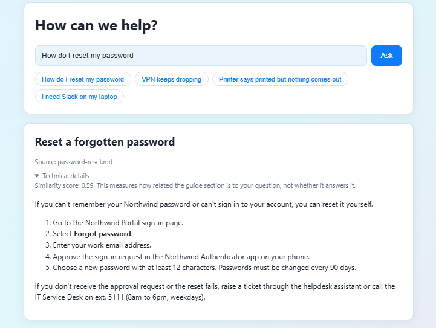
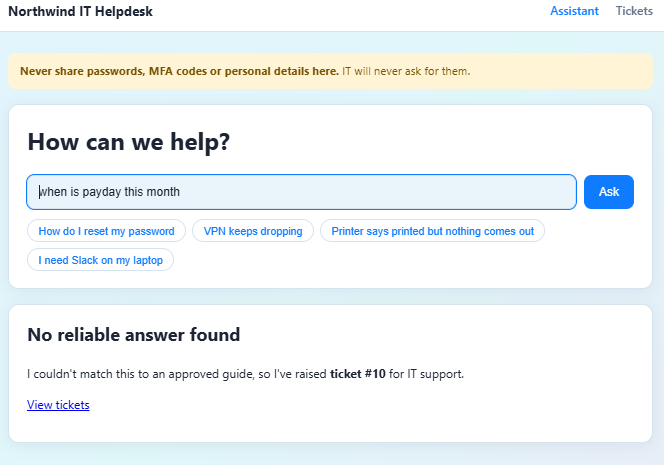
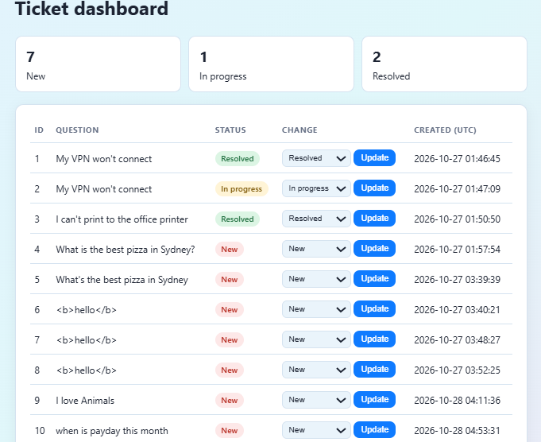
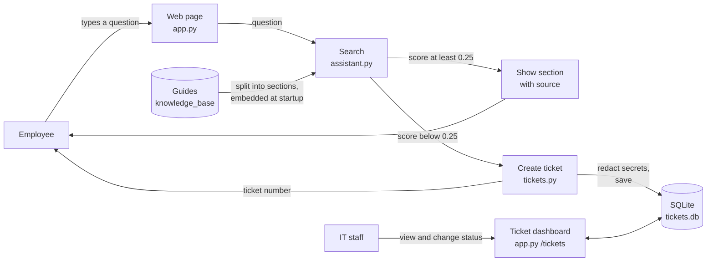

# AI IT Helpdesk Knowledge Assistant

A prototype helpdesk assistant for a fictional company (Northwind Logistics). Employees ask IT questions in plain language. The assistant finds the most relevant section of an approved support guide and shows it with its source. If it cannot find a reliable match, it raises a ticket that IT staff can track.

I built this after repeatedly running into support chatbots that loop through the same options, or that understand the problem and then never connect you to a person. I wanted to find out how a helpdesk assistant could answer only from approved guides, avoid guessing, and hand over to a human through a trackable ticket when it cannot help. It is a learning project, built with guidance from an AI assistant (Claude), which drafted some of the guides and test questions that I reviewed and edited.

## Demo

A 50-second walkthrough: asking a question, getting a cited answer, escalating an uncovered question to a ticket, and changing its status.
https://github.com/user-attachments/assets/0892f25c-3df4-458e-813f-ff4d5aaef318

## Screenshots

An answer, with its source:

A ticket raised when no reliable answer exists:

The ticket dashboard. Tickets 6 to 8 are a test of HTML escaping: the text is shown as typed.

## What it does

- Searches 16 sections across five guides: password and MFA, Wi-Fi, VPN, software installation, and printing and hardware.
- Uses meaning-based search (sentence embeddings), so "I can't get online" can match a Wi-Fi guide without sharing words.
- Shows the source file with every answer, and the similarity score in a collapsed "Technical details" section.
- Escalates to a ticket when the best match scores below a threshold (0.25).
- Removes obvious secrets (for example "password is ...") before saving a ticket.
- Includes a ticket dashboard where staff can change a ticket's status (New, In progress, Resolved).

## What it does not do

- It does not generate new answers. It returns the guide text itself, so it cannot invent steps that are not in a guide.
- It does not change anything on a device or grant access. It gives guidance only.
- It is not production-ready: there is no login on the ticket dashboard (see Limitations).

## How it works

1. Guides in `knowledge_base/` are split into sections, one per `##` heading.
2. Each section is converted to an embedding with `all-MiniLM-L6-v2`.
3. A question is converted the same way, and the closest section is found by cosine similarity.
4. If the score is at least 0.25, the section is shown. Otherwise a ticket is created in SQLite.

## Architecture

## Evaluation

I measured the assistant on written test questions with expected outcomes (a section title, or "escalate"). Results were split into correct answers, wrong answers served, and unnecessary escalations.

| Test set | Questions | Correct | Wrong answer served | Over-escalated |
|---|---|---|---|---|
| Main set | 31 | 25 | 6 | 0 |
| Fresh holdout (written after the knowledge base was complete) | 12 | 7 | 5 | 0 |

Findings:
- Questions the guides cover are answered well: 22 of 24 on the main set and 6 of 7 on the holdout.
- Questions the assistant should hand to a human often are not escalated. On the holdout, only 1 of 5 out-of-scope or vague questions escalated. Wrong answers scored 0.26 to 0.35, above the threshold, while some correct answers scored as low as 0.40 to 0.45.
- The similarity score measures how related a section is to a question, not whether the section answers it, so a single threshold cannot separate right from wrong.
- A gap rule (escalate when the top two scores are close) helped on the tuning set but did not generalise to fresh questions, so it is switched off.
- Adding a guide can break questions that used to work. For example, "My VPN won't connect" returned Wi-Fi steps until a VPN guide was written, and adding a printing guide made a vague question match it. The whole test set must be re-run after every change.
- Questions near the threshold are fragile. "when is payday this month" escalated (score 0.21), but the same question with a trailing full stop scored 0.25 and returned a confident wrong answer.

What surprised me most was how an embedding search can look confident and still be wrong. The assistant never makes up an answer, because it always returns the closest section of a guide, but for questions it should hand to a human, such as "my second monitor has stopped working" or "it won't let me in", the closest section still scored above my threshold, so it served a confident wrong answer. The threshold caught obvious cases like pizza, but not these near-misses, and I measured that instead of assuming it was fixed. Next I would try asking a clarifying question for vague requests, and checking whether the retrieved section really answers the question before showing it.

## Limitations

- The test questions were written by me with help from an AI assistant that knew the guides, so they are easier than questions from real users. The sample sizes are small, so percentages are indicative only.
- Real company IT procedures are confidential, so the guides are original demonstration content for a fictional organisation. Results show the technique works, not that it fits any specific company.
- The ticket dashboard has no login and no protection against forged requests (CSRF). Anyone who can reach it can read and change tickets.
- Junk questions create tickets, and there is no duplicate detection or rate limiting.
- Secret redaction only catches common patterns (for example, "password is ..."). "Summer2026 is my password" would not be caught.
- Vague questions such as "it won't let me in" tend to match a guide with a confident wrong answer instead of asking for more detail.

## Run it

Requires Python 3.13 or similar.

    python -m venv venv
    venv\Scripts\activate
    pip install -r requirements.txt
    python app.py

Then open http://127.0.0.1:5000 in your browser. This address only works on your own computer while the app is running. The first run downloads the embedding model (about 90 MB). The ticket dashboard is at /tickets.

To run the evaluation:

    python experiments/evaluate_v1.py

## Project structure

- `knowledge_base/`: the guides and a facts sheet
- `tests/`: test questions with expected outcomes
- `experiments/`: evaluation script, ticket functions, and the earlier experiments
- `docs/`: project scope, learning log and screenshots
- `app.py`, `assistant.py`: the web app and the search

## Evidence and scope

See `docs/scope.md` for the problem statement, evidence sources and success measures, and `docs/learning-log.md` for what I tried and learned at each step.
